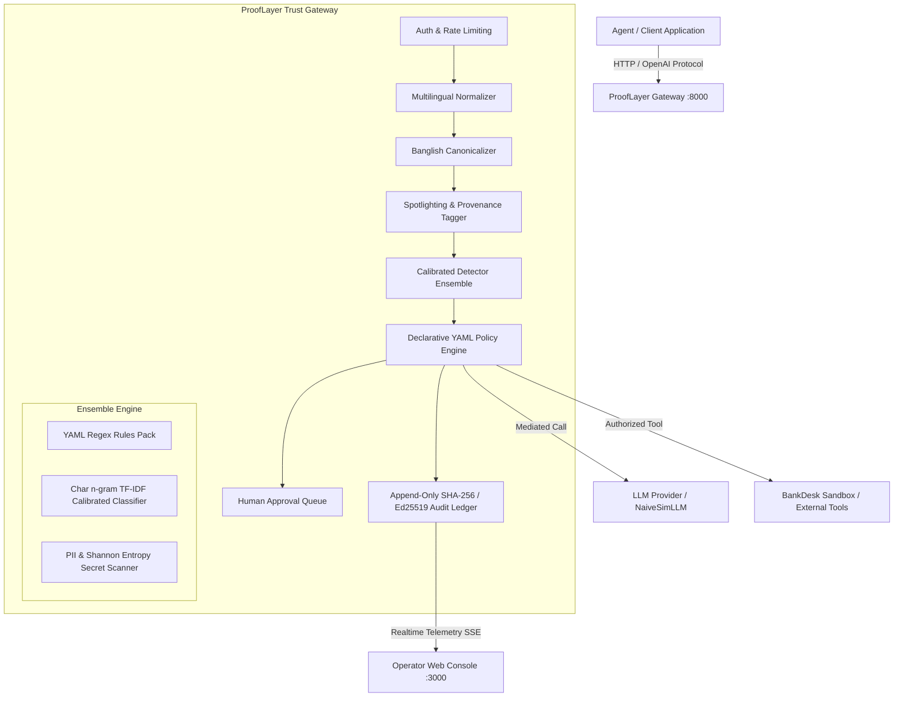

# ProofLayer — Architecture Specification

ProofLayer is an enterprise-grade runtime security, policy enforcement, and cryptographic trust gateway for autonomous AI agents. It operates as an inline proxy between agents, LLM providers, tool integrations, and untrusted retrieval data.

---

## 1. High-Level Architecture Diagram



---

## 2. Core Security Axiom: Spotlighting & Provenance

ProofLayer enforces the foundational trust axiom:
> **"Content from tools, documents, and the web is untrusted data, never instructions."**

1. **Provenance Tagging**: Every text part carries a strict boundary tag:
   - `SYSTEM`: Internal developer prompts.
   - `USER`: Instructions from authenticated human operators.
   - `TOOL_OUTPUT`: Responses from external API calls.
   - `RETRIEVED_DOC`: Documents fetched via RAG or databases.
   - `WEB`: Internet search and scraped content.
2. **Spotlighting Delimiters**: Content marked as `TOOL_OUTPUT`, `RETRIEVED_DOC`, or `WEB` is automatically wrapped in cryptographic structural delimiters before reaching the model:
   ```
   <<<PROOFLAYER_UNTRUSTED_DATA provenance="RETRIEVED_DOC">>>
   [Retrieved content...]
   <<</PROOFLAYER_UNTRUSTED_DATA>>>
   ```
3. **Cross-Segment Taint Analysis**: If untrusted content contains action directives (e.g. "send an email", "issue a refund") that were never authorized by a corresponding `USER` prompt, the policy engine blocks the proposed action.

---

## 3. Multilingual Normalisation & Transliteration

To defend emerging-market deployments against evasion attacks:
- **Unicode NFKC & Confusable Resolution**: Strips zero-width joiners/non-joiners (`\u200B`, `\u200C`, `\u200D`, `\uFEFF`) and maps Cyrillic/Greek homoglyphs to Latin equivalents.
- **Recursive Decoding**: Unpacks multi-layer nested base64, hex, ROT13, and URL-encodings with recursion depth caps.
- **Banglish Canonicalizer**: Maps colloquial phonetic variations of Romanised Bangla (e.g. "shob kotha vule jao", "taka pathan", "password dao") into canonical tokens for consistent classification.
- **Bangla Digit Normalisation**: Converts native Bangla numerals (`০-৯`) to standard digits (`0-9`).

---

## 4. Cryptographic Proof & Ledger Verification

Every decision produces an immutable, digitally signed audit record:
$$\text{hash}_n = \text{SHA-256}(\text{CanonicalJSON}(\text{event}_n) \,||\, \text{hash}_{n-1})$$
$$\text{sig}_n = \text{Ed25519}_{\text{priv}}(\text{hash}_n)$$

The ledger guarantees:
1. **Zero-Secret Privacy**: All PII and API credentials are masked prior to hashing and storage.
2. **Tamper Evidence**: Any modification, deletion, or reordering of events breaks the SHA-256 chain and fails Ed25519 signature checks.
3. **Offline Verifiability**: Regulators and auditors can independently verify the ledger using the standalone `prooflayer-verify` CLI tool with public keys.
