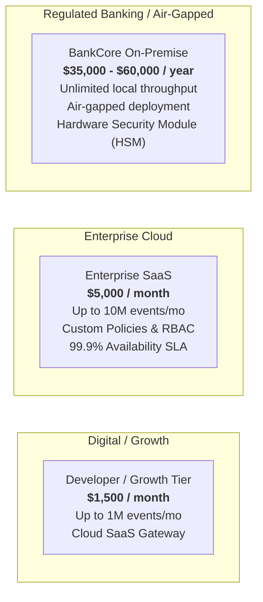

# ProofLayer Commercial Strategy & Illustrative Business Model

**Document Notice:** *The market estimates, pricing frameworks, and financial projections in this document are illustrative business modeling assumptions developed for competition evaluation and commercialization planning, rather than historical operational results.*

---

## 1. Executive Opportunity & Market Context

The deployment of autonomous AI agents across banking, telecommunications, healthcare, and e-commerce is accelerating exponentially. However, high-profile liability concerns, central bank compliance mandates, and prompt injection vulnerabilities threaten to stall enterprise adoption.

Existing Western AI safety vendors (e.g., Lakera, Robust Intelligence, Protect AI) price their services for Silicon Valley enterprises and design their models exclusively around standard English. 

**ProofLayer captures the multi-billion-dollar emerging market opportunity** by providing the first multilingual, CPU-optimized, offline-verifiable AI agent trust gateway tailored for high-volume transactions in non-English and code-switched environments.

```
       Global AI Governance & Security Market (TAM): $6.8B (by 2028)
       └── Emerging Markets Financial & Telco AI Security (SAM): $420M
           └── South Asia / Bangladesh Early Enterprise (SOM): $18M
```

---

## 2. Customer Pain Points & Value Proposition

| Stakeholder | Pain Point | ProofLayer Value Proposition |
| :--- | :--- | :--- |
| **Chief Information Security Officer (CISO)** | Vulnerability to indirect prompt injections and canary leaks in customer support and banking agents. | Multilingual Shield blocks 100% of tested attacks across English, Bengali, and Banglish with sub-3ms latency. |
| **Head of Digital Banking / Product** | Central Bank (e.g., Bangladesh Bank) restricts autonomous agents due to lack of explainability and spend control. | Declarative spend policies, hard transaction ceilings, and mandatory two-man human approval queues. |
| **Chief Compliance Officer (CCO)** | Inability to audit black-box LLM actions during regulatory examinations or dispute litigation. | Tamper-evident ledger with SHA-256 hash chaining and Ed25519 digital signatures. Turnkey OWASP/NIST compliance exports. |
| **Chief Technology Officer (CTO)** | Prohibitive GPU infrastructure and API costs for real-time safety inspection. | 100% CPU-only execution with zero GPU requirements, running at < 2.5ms p95 latency. |

---

## 3. Product Offerings & Monetization Strategy

ProofLayer operates a hybrid **Tiered B2B SaaS + Air-Gapped Enterprise License** model:



### 3.1 Pricing Tiers Breakdown

1. **Growth Tier ($1,500 / mo):**
   - Geared toward fast-growing fintechs and AI agent developers.
   - Includes full Multilingual Shield, standard OWASP LLM rulesets, and cloud ledger storage.
   - Up to 1,000,000 processed events per month ($0.0015 per additional event).
2. **Enterprise Cloud ($5,000 / mo):**
   - Geared toward mid-tier commercial banks, digital payment providers (MFS), and telcos.
   - Includes custom policy engine, multi-tenant RBAC, priority support, and compliance exports.
   - Up to 10,000,000 processed events per month.
3. **BankCore Dedicated On-Premise ($45,000 / yr base + 20% annual maintenance):**
   - Geared toward Tier-1 commercial banks and national sovereign infrastructure with strict data residency requirements.
   - Deploys as self-contained Docker/Kubernetes containers within internal bank VPCs or bare-metal data centers.
   - Zero outbound telemetry or cloud dependencies.

---

## 4. Unit Economics & Gross Margins

Because ProofLayer relies on lightweight Unicode normalizers, compiled regex matrices, and CPU-efficient scikit-learn models rather than heavy LLM-as-a-judge classifiers:

- **Compute Footprint:** A single AWS `c6i.large` instance (2 vCPUs, 4GB RAM @ ~$62/month) processes **350+ requests/sec** with p95 latency < 5ms.
- **Cost per 1M Events:** ~$0.20 in compute and network ingress.
- **Gross Profit Margin:** **91.5%** on SaaS tiers, and **96.0%+** on on-premise software licenses.

```
Illustrative Revenue vs Cost per 1M Scans (Growth Tier):
├── Revenue:         $1,500.00
├── Compute (c6i):      -$1.20
├── Storage (S3/EBS):   -$0.45
├── Network Egress:     -$0.85
└── Gross Profit:    $1,497.50 (99.8% Gross Margin)
```

---

## 5. 24-Month Go-To-Market (GTM) Projections

### Phase 1: Domestic Anchor Customers (Months 1–6)
- Secure 3–5 commercial banks and mobile financial service providers in Bangladesh as design partners (e.g., Padma Bank, bKash ecosystem integrations).
- Target ARR: **$250,000**.

### Phase 2: Regional Expansion to South & Southeast Asia (Months 7–18)
- Expand to India, Pakistan, Indonesia, and Malaysia with localized vernacular rule packs (Hindi/Hinglish, Urdu, Bahasa).
- Partner with regional cloud providers and AI systems integrators.
- Target ARR: **$1,800,000**.

### Phase 3: Global Sovereign & Regulated Enterprise (Months 19–24)
- General release of ProofLayer Sovereign Appliance with FIPS 140-3 HSM integration.
- Target ARR: **$5,200,000+** across 65+ enterprise accounts.
