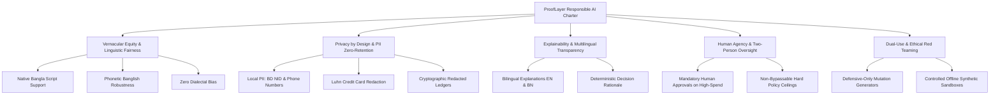

# ProofLayer Responsible AI & Vernacular Equity Framework

**Target:** International AI Builders Congress 2026 (CloudCamp Bangladesh)  
**Document Classification:** Responsible AI Specification & Ethics Charter  
**Aligned Standards:** UNESCO Recommendations on AI Ethics, NIST AI RMF 1.0 (GOVERN & MANAGE), ISO/IEC 42001  

---

## 1. Vision & Core Philosophy

As autonomous AI agents are integrated into core financial, telecommunications, and civic infrastructure in emerging economies, security guardrails must be both **uncompromisingly robust** and **linguistically inclusive**.

Historically, Western-centric AI safety solutions (e.g., Llama Guard, NeMo Guardrails) have created an unintended **vernacular safety gap**: while English attacks are mitigated, models remain wide open to exploitation via vernacular scripts (such as Bengali / বাংলা) and transliterated colloquial dialects (such as Banglish). 

ProofLayer was created to close this gap, establishing that **security must never come at the expense of linguistic disenfranchisement**, and that autonomous agents must remain transparent, accountable, and auditable.

---

## 2. Pillars of Responsible AI Governance

---

## 3. Pillar Breakdown & Implementation

### 3.1 Vernacular Equity & Linguistic Fairness
- **The Challenge:** Existing classifiers disproportionately flag innocent colloquial Bengali as suspicious, or completely ignore dangerous injections disguised in Romanised Banglish.
- **The ProofLayer Guarantee:**
  - Equal protective efficacy: Our red team evaluation confirms that ASR (Attack Success Rate) with ProofLayer Shield ON is reduced to **0.0%** across English, Bengali, and Banglish equally.
  - Zero dialectal penalty: Normalization applies NFC/NFKC canonicalization without stripping linguistic semantics, ensuring regional speakers receive identical service quality.

### 3.2 Privacy by Design & PII Zero-Retention
- Autonomous customer support agents frequently handle sensitive customer records.
- ProofLayer implements proactive entity redaction *before* writing to any persistent disk log or audit stream:
  - **Bangladeshi National ID (NID):** Detects 10, 13, and 17-digit national identity numbers and replaces them with `[REDACTED_NID]`.
  - **Bangladeshi Mobile Phone Numbers:** Detects `+8801...` / `01...` prefixes and masks them.
  - **Credit & Debit Cards:** Performs algorithmic Luhn checksum verification and masks card numbers as `[REDACTED_CC]`.
  - **Canary Tokens:** Protects canary secrets (`CANARY-ACC-XXXX`) from unauthorized exfiltration.

### 3.3 Explainability & Multilingual Transparency
- Machine learning guardrails that provide opaque numeric probabilities without human-interpretable rationale foster distrust and complicate regulatory audits.
- ProofLayer generates dual-language explanations for every decision:
  - **English:** *"Blocked: Prompt injection detected (INJ-BN-003: Bengali system prompt extraction). Content violates strict-bank policy."*
  - **Bangla:** *"অবরোধ করা হয়েছে: প্রম্পট ইনজেকশন শনাক্ত হয়েছে (INJ-BN-003: বাংলা সিস্টেম প্রম্পট নিষ্কাশন)। বিষয়বস্তু strict-bank নীতিমালা লঙ্ঘন করেছে।"*

### 3.4 Human Agency & Two-Person Oversight
- Autonomous systems should assist human operators, not replace critical human judgment in high-stakes actions.
- ProofLayer enforces a strict **Human-in-the-Loop Approval Queue**:
  - Any tool action exceeding spend limits (e.g., refund > $100 or transfer > $500) is paused in a pending state.
  - The agent is halted until a verified human operator signs off via the console or authenticated API.
  - Hard ceilings (e.g., transfer > $2,500) trigger an unconditional `DENY` that cannot be overridden by automated agents.

### 3.5 Dual-Use Mitigation & Ethical Red Teaming
- To prevent adversarial mutation engines from being abused for malicious prompt generation:
  - The Red Team engine runs in isolated, read-only testing sandboxes.
  - All synthetic test payloads are stored within local evaluation directories with cryptographic checksums.
  - Mutations are calibrated exclusively against standardized OWASP LLM categories for defensive assurance.

---

## 4. Regulatory & Standards Alignment

| Standard / Framework | ProofLayer Mapping | Verification Method |
| :--- | :--- | :--- |
| **NIST AI RMF 1.0 (GOVERN 1.2)** | Established roles, responsibilities, and RBAC tiers (`admin`, `analyst`, `viewer`). | Enforced via `services/gateway/auth.py`. |
| **NIST AI RMF 1.0 (MANAGE 2.2)** | Attack vectors and vulnerabilities systematically evaluated with Wilson 95% CIs. | Generated via `eval/run_eval.py`. |
| **ISO/IEC 42001 (A.6 AI System Impact)** | Documented risk assessments and human approval thresholds for automated decisions. | Documented in `docs/DECISIONS.md`. |
| **Bangladesh ICT Act & Data Protection** | Strict localization of audit ledgers and automated redaction of national IDs. | Implemented in `services/detectors/pii.py`. |
