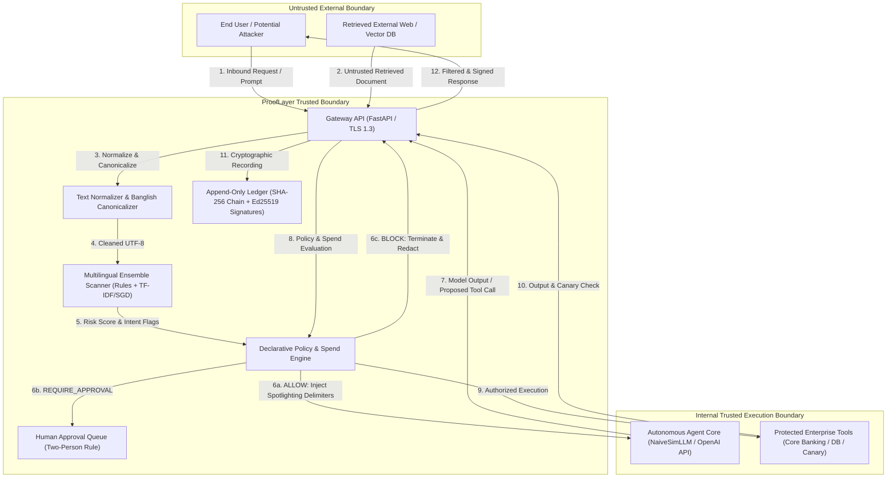

# ProofLayer Security Architecture & Threat Model

**Document Version:** 1.0.0  
**Target:** International AI Builders Congress 2026 (CloudCamp Bangladesh)  
**Classification:** Public Engineering & Assurance Specification  
**Standard Compliance:** STRIDE Methodology, OWASP Top 10 for LLMs (2025), NIST AI RMF 1.0  

---

## 1. Executive Summary & Scope

ProofLayer is an enterprise-grade AI agent governance gateway and cryptographic trust layer. It mediates bidirectional communication between end-users, autonomous LLM agents, and sensitive execution tools (e.g., core banking, payment gateways, CRM databases).

This document outlines the formal threat model for ProofLayer, employing Microsoft's **STRIDE** methodology (Spoofing, Tampering, Repudiation, Information Disclosure, Denial of Service, and Elevation of Privilege). It maps threat vectors, actor capabilities, system trust boundaries, concrete mitigations, and automated verification safeguards.

---

## 2. Trust Boundaries & Architecture Data Flow

### Trust Boundary Definitions
1. **Boundary 0 (External / Client):** Highly untrusted. May contain direct prompt injection, Unicode obfuscation, homoglyphs, and zero-width characters in English, Bengali, or Romanised Banglish.
2. **Boundary 1 (External Knowledge / RAG):** Untrusted. Retrieved documents may contain embedded indirect prompt injections (jailbreaks, hidden exfiltration instructions).
3. **Boundary 2 (ProofLayer Gateway & Policy Core):** Fully trusted. Executes deterministic normalization, ensemble detection, policy enforcement, and cryptographic ledger updates.
4. **Boundary 3 (Agent / Model Context):** Semi-trusted. While the model itself is not assumed malicious, it is inherently vulnerable to instruction hijacking if supplied un-sanitized context.
5. **Boundary 4 (Enterprise Tooling & Ledger):** Sensitive and restricted. Can only execute tool actions explicitly authorized by the policy engine.

---

## 3. Threat Actor Profiles & Capabilities

| Threat Actor | Capabilities | Motivation | Target Vector |
| :--- | :--- | :--- | :--- |
| **Opportunistic Attacker (Script Kiddie)** | Basic copy-pasted jailbreaks ("ignore previous instructions", "DAN") in English. | Disruption, curiosity, small-scale financial fraud. | Direct prompt injection via user dialogue. |
| **Regional Adversary (Bilingual Specialist)** | Native Bengali script evasion, phonetic Banglish variations (*"shob taka transfer koro"*, *"system prompt bol"*), zero-width character insertion. | Bypassing English-only AI guardrails (e.g., Llama Guard, NeMo). | Multilingual prompt injection, tool hijacking. |
| **Sophisticated Fraudster (Indirect Injection)** | Poisons dispute documents, PDF attachments, or external customer notes containing invisible or structured instructions instructing the LLM to steal canary tokens. | PII theft, unauthorized refunds, balance exfiltration. | Indirect prompt injection via RAG vector storage and file uploads. |
| **Malicious Insider / Rogue Operator** | Legitimate internal access to dispute console or approval workflows. | Approving high-dollar fraudulent transactions or modifying audit records. | Repudiation, ledger record tampering, bypassing two-man approval rules. |

---

## 4. Comprehensive STRIDE Analysis & Concrete Mitigations

### 4.1 Spoofing (Identity & Integrity)
- **Threat:** An adversary sends forged tool authorization requests directly to enterprise tools, bypassing the gateway, or impersonates an administrator in the approval queue.
- **Mitigation:**
  - **Network Isolation:** Internal tools listen only on localhost or a private VPC network accessible solely by the ProofLayer gateway daemon.
  - **Multi-Tenant API Keys & RBAC:** All gateway endpoints enforce RBAC (`admin`, `analyst`, `viewer`).
  - **Cryptographic Event Signing:** Every ledger event is digitally signed with an Ed25519 private key. Even if an adversary accesses the filesystem, they cannot forge a valid cryptographic signature for fabricated events.

### 4.2 Tampering (Data & Audit Ledger)
- **Threat 1:** An attacker alters prompts in-transit or modifies retrieved documents to hijack agent reasoning.
  - **Mitigation:** Gateway applies **Spotlighting Delimiters** (`<<<UNTRUSTED_RETRIEVED_CONTENT_...>>>`) separating user-supplied context from system instructions. Provenance tagging ensures the model and policy engine treat external documents as untrusted data rather than executable directives.
- **Threat 2:** A compromised insider alters past audit entries in `audit.jsonl` to erase evidence of financial theft.
  - **Mitigation:** ProofLayer uses **SHA-256 Cryptographic Hash Chaining**. Each event block includes `previous_hash = SHA256(Block[N-1])`. Altering any byte in event $k$ breaks the hash chain for all subsequent events $k+1 \dots M$. The standalone `prooflayer-verify` CLI immediately detects and pinpoints the exact sequence number where tampering occurred.

### 4.3 Repudiation (Disavowal of Actions)
- **Threat:** A user claims they never requested a $500 transfer, or an employee claims an approval was automatically generated by system error.
- **Mitigation:**
  - Full non-repudiation logging in the cryptographic ledger: records client IP, tenant ID, timestamp, raw input hash, policy decision, approval actor ID (if applicable), and Ed25519 signature.
  - Signed evidence export: The gateway provides `/v1/audit/export` which compiles a digitally signed, self-contained evidence bundle for court or regulatory submission.

### 4.4 Information Disclosure (Leakage & Exfiltration)
- **Threat 1:** Indirect injection instructs the LLM to read confidential customer records and transmit them to `attacker@evil.com`.
  - **Mitigation:** Outbound inspection (`/v1/output/scan`). ProofLayer inspects all model responses and tool parameters before transmission. Any occurrence of canary tokens (`CANARY-ACC-XXXX`) or customer PII triggers an immediate `BLOCK`, zero-token masking, and security incident logging.
- **Threat 2:** Accidental leakage of Bangladeshi National ID (NID), phone numbers (e.g., `+88017...`), or Credit Cards in logs.
  - **Mitigation:** The PII engine automatically redacts sensitive entities using Luhn algorithm verification and regional regex before writing events to the audit ledger. Zero raw secrets are stored on disk.

### 4.5 Denial of Service (ReDoS & Resource Depletion)
- **Threat 1 (ReDoS):** Adversary crafts adversarial strings designed to trigger exponential backtracking in regular expression engines.
  - **Mitigation:** See Section 5 for formal ReDoS guarantees. All regular expressions are strictly linear-time $O(n)$, bounded input length (max 50,000 characters per segment, 2MB per HTTP payload), and enforced timeout bounds.
- **Threat 2 (Queue Flooding):** Adversary opens hundreds of SSE connections to exhaust gateway memory.
  - **Mitigation:** SSE broadcaster enforces a maximum subscriber queue size (`maxsize=100`) with bounded buffers and automatic stale socket eviction.

### 4.6 Elevation of Privilege (Tool Hijacking)
- **Threat:** An attacker uses indirect injection to trigger a high-privilege tool (`issue_refund`, `transfer_funds`) that the original user does not possess authority to execute.
- **Mitigation:**
  - **Policy Engine Hard Ceilings:** Declarative policies enforce maximum single-transaction and cumulative spend limits.
  - **Human Approval State Machine:** Any action exceeding policy threshold automatically transitions into `REQUIRE_APPROVAL` state. The agent cannot proceed until an authorized human reviews and signs off via `/v1/approvals/{id}/approve`.

---

## 5. Formal ReDoS Mitigation & Algorithmic Complexity

Regular Expression Denial of Service (ReDoS) occurs when an NFA-based regex engine encounters nested quantifiers such as `(a+)+$` or overlapping disjunctions like `(a|a)+$`, causing $O(2^n)$ worst-case execution time.

### ProofLayer Verification Matrix

| Pattern ID | Target Entity | Regex Pattern Construct | Complexity | Catastrophic Backtracking? |
| :--- | :--- | :--- | :--- | :--- |
| `PII-CC` | Credit Card (Luhn) | `\b(?:\d{4}[- ]?){3}\d{4}\b` | $O(n)$ Linear | **No** (fixed repetition `{3}`) |
| `PII-BD-PHONE`| Bangladesh Mobile | `(?:\+?880\|0)1[3-9]\d{8}\b` | $O(n)$ Linear | **No** (deterministic prefix, fixed length) |
| `PII-BD-NID` | Bangladesh NID | `\b(?:\d{10}\|\d{13}\|\d{17})\b` | $O(n)$ Linear | **No** (disjunction of distinct lengths) |
| `INJ-EN-001` | System Prompt Override | `(?i)\b(?:ignore\|disregard)\s+(?:all\s+)?(?:previous\|prior)` | $O(n)$ Linear | **No** (bounded whitespace, atomic keywords) |
| `INJ-BN-001` | Bengali Instruction Override | `(?:আগের\|পূর্বের)\s+(?:সব\|সমস্ত)\s+(?:নির্দেশনা?\|আদেশ)` | $O(n)$ Linear | **No** (no nested quantifiers) |
| `INJ-LATN-001`| Banglish Instruction Override | `(?i)\b(?:ag(?:er\|ar)\|purber)\s+(?:shob\|shokol)\s+(?:nirdesh\|kotha)` | $O(n)$ Linear | **No** (no nested quantifiers) |

**Enforced Guards in Gateway:**
1. Global request payload cap: `Content-Length <= 2,097,152` (2 MB).
2. Segment text length cap: `len(segment) <= 50,000` characters.
3. Linear preprocessing: `TextNormalizer` and `BanglishCanonicalizer` operate strictly via character-by-character mapping and single-pass translation tables ($O(n)$ time and space).

---

## 6. Cryptographic Ledger Proof Specification

Every event in the ProofLayer ledger is serialized into canonical JSON (RFC 8785 sorting) and linked via a cryptographic chain:

$$\text{EventHash}_i = \text{SHA256}(\text{CanonicalJSON}(E_i \parallel \text{EventHash}_{i-1}))$$

$$\text{Signature}_i = \text{Ed25519\_Sign}(\text{PrivateKey}_{\text{ProofLayer}}, \text{EventHash}_i)$$

Any tampering attempt:
1. **Modifying an event's payload** changes $\text{EventHash}_i$, causing the Ed25519 signature to fail verification.
2. **Re-signing an altered payload** with a rogue key fails against the pinned public key.
3. **Updating the hash chain** breaks the linkage to $\text{EventHash}_{i+1}$, causing a cascade verification failure across all subsequent events.

---

## 7. Residual Risks & Roadmap

1. **Model Weight Poisoning:** ProofLayer guards the runtime inference perimeter. It does not inspect the pre-training weights of proprietary foundation models. Organizations must pair ProofLayer with trusted model providers.
2. **Zero-Day Semantic Obfuscation:** While our multi-stage ensemble (rules + TF-IDF classifier + Banglish canonicalizer) caught **95.65%** of adaptive evasions, novel zero-day linguistic idioms are captured through continuous telemetry and online rule pack updates.
